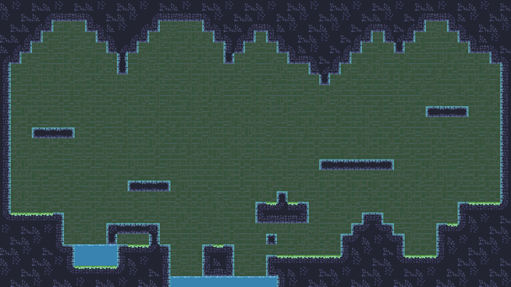

# Lab 2 — Glimmer Grotto, part 1

Sprite sheet'ler, tilemap'ler, sorting layer'lar ve rule tile. Unity projesi: [`GlimmerGrotto/`](../../GlimmerGrotto/)
(Lab 3 aynı projede devam eder).

## Görsel paketi

Lab zip'indeki paket, kılavuzdaki `terrain.png` adlı paketin değil, Lab 3 kılavuzundaki **course sprite pack**'in
dosyalarıdır (SPA_*). Kesim ayarları Lab 3 kılavuzu Tablo 1 ile aynıdır.

| Dosya | Mode | PPU | Kesim (Grid By Cell Size) | Sprite |
| ----- | ---- | --- | ------------------------- | ------ |
| SPA_Rock_Grass_Water.png | Multiple | 32 | 32×32, Padding 6×6 | 30 karo (_0 … _29) |
| SPA_Background.png | Multiple | 32 | 32×32, Padding 6×6 | 16 duvar karosu |
| SPA_Player_Bronze / Ginger.png | Multiple | 32 | 32×32, Padding 6×6 | 29 kare: shoot 5, idle 4, roll 5, climb 2, jump 3, run 10 |
| SPA_Enemy_Right_Red / Yellow.png | Multiple | 32 | 32×32, Padding 6×6, **Offset 10×2** | 6 yürüme karesi |
| SPA_Coins.png | Multiple | 32 | 32×32, Padding 6×6 | 12 kare |
| SPA_Ladder.png, Spikes.png | Single | 32 | — | 1 |
| doorway-white.png | Single | **64** | — | 1 (2×2 birim) |

Hepsi **Filter Mode: Point (no filter)**, **Compression: None**.

## Kılavuzdaki karo adlarının karşılığı

| Kılavuz | Parça | Bu paket (`SPA_Rock_Grass_Water_N`) |
| ------- | ----- | ----------------------------------- |
| terrain_0, 1, 2 | Üst kenar (yosun) | **6, 7, 8** (çimen) |
| terrain_3 | Sol üst köşe | 0 |
| terrain_4, 5 | Sol yan | 5, 10 |
| terrain_6 | Sol alt köşe | 15 |
| terrain_7, 8 | Alt kenar | 16, 17 |
| terrain_9, 10, 11 | Dolgu | 11, 12, 21, 22 |
| terrain_12 | İç köşe (sol üst çentik) | 26 |
| terrain_13 | Tek blok | 3 |
| terrain_14, 15, 16 | Sütun üstü / ortası / altı | 4, 9, 14 |
| terrain_17, 18 | Çıkıntı ucu (sol) / ortası | 23, 24 |
| terrain_19, 20 | Su yüzeyi / derin su | 29, 28 |

## GrottoRuleTile (13 kural, yukarıdan aşağı)

`+` bu rule tile olmalı, `×` olmamalı, boş: fark etmez. Default Sprite: 6.

| # | Kural | Komşular | Transform | Çıktı |
| - | ----- | -------- | --------- | ----- |
| 1 | Tek blok | üst × sol × sağ × alt × | Fixed | 3 |
| 2 | Sütun üstü | üst × sol × sağ × alt + | Fixed | 4 |
| 3 | Sütun ortası | üst + sol × sağ × alt + | Fixed | 9 |
| 4 | Sütun altı | üst + sol × sağ × alt × | Fixed | 14 |
| 5 | Çıkıntı ucu | üst × sol × sağ + alt × | Mirror X | 23 |
| 6 | Çıkıntı ortası | üst × sol + sağ + alt × | Fixed | 24 |
| 7 | Üst köşe | üst × sol × sağ + alt + | Mirror X | 0 |
| 8 | Alt köşe | üst + sol × sağ + alt × | Mirror X | 15 |
| 9 | İç köşe | sol üst × üst + sol + sağ + alt + | Rotated | 26 |
| 10 | Üst kenar | üst × sol + sağ + alt + | Fixed | Random: 6, 7, 8 |
| 11 | Alt kenar | üst + sol + sağ + alt × | Fixed | Random: 16, 17 |
| 12 | Yan | üst + sol × sağ + alt + | Mirror X | Random: 5, 10 |
| 13 | Dolgu | üst + sol + sağ + alt + | Fixed | Random: 11, 12, 21, 22 |

## Unity'de

Menü **Glimmer Grotto → 1. Lab 2'yi kur** Part 1–6'yı uygular: içe aktarma ve kesim, `Assets/Tiles` karoları,
`MainPalette`, `Tilemaps › Background / Water / Platforms` (her biri kendi sorting layer'ında), `GrottoRuleTile`,
yukarıdaki bölüm ve Platforms üzerinde `GroundPainter` (bileşenin ⋮ menüsü → **Paint Ground**, bölümün sağındaki
boş alana boyar).

### Sahne ayrıntıları

- **Bölüm** 48 × 27 karo (16:9). Kamera (orthographic size 13,5) tam olarak bu alanı gösterir. Haritanın kenarındaki
  kaya, görüş alanının 2 karo dışına uzar; böylece rule tile kenarlarda çimen ya da dış yüz çizmez.
- **Işık:** Sahne şablonundaki *Global Light 2D* yalnızca *Default* katmanını aydınlatır. URP 2D'de ışık almayan
  sprite siyah görünür; araç **Target Sorting Layers**'ı bütün katmanlara (All) çevirir.
- **Karo arası çizgiler:** Sheet'lerdeki 6 piksellik boşluklar şeffaf. Ekran ölçeği tam sayı değilken bir karo kenarı
  tam bir piksel merkezine denk gelirse Unity o boşluktan örnek alır ve ince siyah bir çizgi görünür (kılavuz Ek D).
  Araç her tilemap'te **Orientation: Custom, Scale 1.002** kullanır: karolar komşularıyla piksel altı ölçüde örtüşür
  (0,001 birim, 32 PPU'da 0,03 piksel), o piksel her iki karonun da içinde kalır ve çizgi oluşmaz. Kılavuzun
  önerdiği Sprite Atlas boşluğu yine şeffaf bırakabildiği için bu yol seçildi; ileride Pixel Perfect Camera gelince
  gerek kalmaz.

## Tamamlama listesi

- [x] Bütün sprite'lar Point ve Compression None; karolar ve karakter 32 PPU, kapı 64 PPU
- [x] Zemin (30), arka plan (16), karakter (29), düşman (6), para (12) ızgarayla kesildi; merdiven, diken, kapı Single
- [x] Tilemaps: Background, Water, Platforms; her biri kendi sorting layer'ında, bu sırayla
- [x] MainPalette gruplara ayrılmış, rule tile su karosu okuyla işaretli
- [x] GrottoRuleTile tek blok, sütun, çıkıntı, kenar, köşe ve iç köşeleri rastgele varyantlarla çözüyor
- [x] Bölüm rule tile ile boyalı; boşluklar, su çukuru ve havada platformlar var
- [x] Opsiyonel: GroundPainter boyuyor, temizliyor, Ctrl+Z ile geri alınıyor

## Değerlendirme soruları

**1. Pixels Per Unit neyi değiştirir, kapı neden karolardan farklı bir değer istiyor?**
PPU, bir Unity biriminin (ızgaranın bir karesinin) kaç pikselden oluştuğunu söyler. Karolarımız 32×32 piksel, PPU 32
olunca bir karo tam bir kareyi doldurur. Unity'nin varsayılanı 100'dür; o zaman karo 0,32 birim kalır. Kapı 128×128
piksel; 32 PPU'da 4×4 birim olur ve karakterin yanında dev gibi durur. 64 PPU'da 2×2 birim olur. Kapı iri piksellerle
çizildiği için pikselleri de diğerleriyle aynı boyutta görünür.

**2. Point filtre piksel sanatı için neden doğru, fotoğraf için neden kötü?**
Bilinear filtre, görüntü büyütülüp küçültülürken her pikseli komşularıyla karıştırır. Fotoğrafta bu yumuşak ve doğal
durur, piksel sanatında ise kenarları bulanıklaştırır. Point (no filter) her pikseli keskin bir kare olarak bırakır;
fotoğrafta ise basamaklı ve kaba görünür.

**3. Automatic kesim ne zaman iyi çalışır, karakter ve paralarda neden başarısız oldu?**
Parçalar şeffaf boşluklarla ayrılmışsa ve her biri bağımsız bir görselse (ör. ayrı ikonlar) Automatic iyi çalışır.
Animasyon karelerinde ise her kareyi olabildiğince sıkı keser, kareler farklı boyutlarda çıkar. Yerinde oynatılınca
ayaklar zıplar, sanatçının çizdiği hafif sekme titremeye dönüşür. Dönen parada da dar kareler daha dar kesilir ve para
kayar. Grid By Cell Size her kareyi aynı boyutta tutar.

**4. Sprite, tile asset, tile palette ve tilemap arasındaki fark nedir?**
Sprite sheet bir boya kutusudur; kesince içinden **sprite**'lar çıkar. Bir sprite tek başına boyanamaz; Unity onu bir
**tile asset**'e sarar. Tile'lar **tile palette**'e, yani ressamın paletine konur. Paletten seçilen tile, sahnedeki
tuval olan **tilemap**'e boyanır.

**5. Sorting layer'lar Order in Layer sayılarından neden daha kolay yönetilir?**
Katmanlara bir kez ad verip Tags and Layers listesinde sürükleyerek sıralarsın; liste sırası çizim sırasıdır.
Order in Layer ile her nesneye sayı vermen ve yeni bir katman eklendiğinde sayıları yeniden kaydırman gerekir.
Order in Layer artık yalnızca aynı sorting layer içindeki sırayı belirler.

**6. İlk dört kuralla boyanan tek sıra neden yalnızca varsayılan sprite'ı gösterdi?**
Üst kenar kuralı "üstte hiçbir şey yok, iki yanda ve **altta** kaya var" der. Tek sırada altta kaya yoktur, kural
eşleşmez. Hiçbir kural eşleşmeyince Unity varsayılan sprite'ı gösterir.

**7. İç köşe neden Dolgu'nun üstünde olmalı? Genel bir kuralın özel bir kuralı gizlediği başka bir durum söyle.**
Unity kuralları yukarıdan aşağı dener ve ilk eşleşende durur. Dolgu yalnızca dört yanda kaya ister ve çaprazlara
bakmaz; iç köşe hücresinde de dört yanda kaya vardır. Dolgu üstteyse iç köşe kuralına hiç sıra gelmez ve duvarın
zemine değdiği kırık çizgi görünmez. Başka örnek: "Yan" kuralı (üst ve alt kaya, bir yan boş) Sütun ortası
kuralından (iki yan boş) önce gelseydi ve iki yanı boş hücreleri de kapsasaydı, sütunlar yanlış kenarlı çizilirdi.
Kısacası özel durumlar üstte, genel kurallar altta.

**8. (Opsiyonel) Aynı seed neden hep aynı zemini üretir?**
`Random.InitState(seed)` Unity'nin rastgele sayı üretecini başa sarar. Üreteç belirlenimcidir: aynı başlangıç
değerinden hep aynı sayı dizisi çıkar. Aynı sayılar aynı düzlükleri, çukurları ve basamakları verir; farklı bir seed
yeni bir dizi ve yeni bir zemin üretir.
